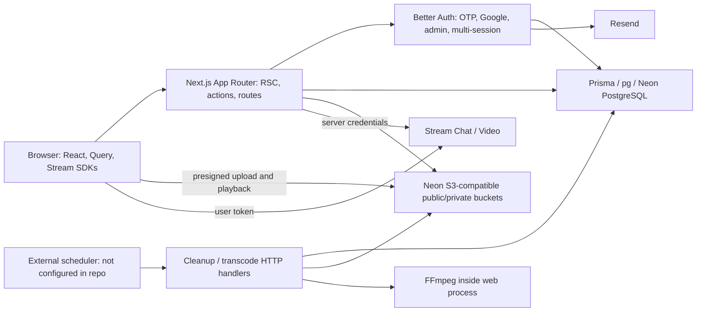

# Knovest application and production-readiness audit

This is the baseline audit. See [October 18 remediation status](REMEDIATION-STATUS-2026-10-18.md) for implemented fixes, approved database/storage changes, verification results and the remaining release blockers.

Audit started: 17 October 2026; completed: 18 October 2026 (India). Scope: repository at `C:\Users\aarif\Programming\PROJECTS\knovest`, local production output, current official documentation, and published service pricing. Filenames retain the audit's start date.

**Decision: NO-GO for public production.** The build works, but authorization failures expose private content and permit unauthorized Stream changes. The admin permission model also permits escalation outside the application's custom admin actions. A limited free beta becomes reasonable only after the security gates and live integration checks in the [remediation plan](REMEDIATION-PLAN-2026-10-17.md) pass. Paid launch additionally requires a real payment and entitlement lifecycle.

This is an application audit, not a claim that the hosted environment was penetrated or certified. Findings distinguish source-confirmed defects, isolated runtime reproductions, local browser measurements, and deployment controls that remain unverified.

## 1. Evidence and limits

Inventory: **417 source files**, including **410 TypeScript/TSX files, 48 pages, 5 API route handlers, and 13 migration directories**. Generated Prisma code excluded from the source-file count. The baseline production manifest registered **91 server actions**.

| Check | Result | Interpretation |
| --- | --- | --- |
| `pnpm test` | 42/42 pass, including after cleanup | Useful isolated regressions; not full integration or browser coverage |
| `pnpm typecheck` | Pass | Route type generation and strict TypeScript succeed |
| `pnpm lint` | Baseline: 0 errors, 193 warnings; after cleanup: 0 errors, 191 warnings | Passing exit status does not mean clean code |
| `pnpm build` | Pass before and after cleanup; production server starts | Local Windows production build, not proof of Linux/serverless deployment compatibility |
| `prisma validate` | Pass | Schema is syntactically valid |
| `prisma migrate status` | Blocked by P1001: database unreachable | Cannot establish applied migration state, drift, query plans, backups, or data integrity |
| `pnpm audit --prod --json` | 0 known advisories | Advisory database result, not a security guarantee |
| `pnpm audit --json` | 1 high, development-only | `braces` through the ESLint dependency chain; details in F29 |
| `pnpm outdated --format json` | Patch updates and several newer majors available | Upgrade selectively; do not treat newest major as mandatory |
| Knip 6.41.0, full and production modes | Dead exports/schema candidates; no unused whole source files confirmed | Manually checked candidates before cleanup |
| Isolated boundary probes | Six mocked boundary failures plus direct Better Auth HTTP role escalation in memory | No real database, storage, mail, or Stream writes performed |
| Browser/HTTP checks | Public pages render; anonymous protected navigation returns to login; media/cron routes reject anonymous requests | Does not establish cross-user authorization after login |
| Browser chunk secret check | No exact matches for configured server secret values in top-level emitted JS chunks | Limited exact-value scan; not a complete history or secret-scanning service |

Working tree was clean at audit start. No deployment, migration application, payment, email delivery, provider permission update, production data modification, or credential rotation was performed.

Local configuration has no support email and uses a local HTTP app origin. That is appropriate for development; it is not a production configuration. An initial browser run on port 3100 failed its session request because the configured client origin was port 3000. Measurements were subsequently made on the matching `http://localhost:3000` origin. The port-3100 mismatch is not classified as a product defect.

Local evidence is retained under `output/audit/` (gitignored): Lighthouse JSON, screenshots, HTTP headers, dependency/outdated output, build/lint logs, Knip results, and isolated probes. Primary artifacts include `lighthouse-mobile.json`, `lighthouse-desktop.json`, `lighthouse-login-mobile.json`, `boundary-probes.cjs`, `boundary-results.json`, `http-checks.json`, and `bundle-sizes.json`. The report preserves the material findings even when those local artifacts are not shared.

## 2. Architecture and design assessment

The existing modular monolith is a sensible starting architecture. There is no demonstrated need for microservices or a replacement framework.

The main design weakness is **inconsistent trust boundaries**, rather than folder organization. Some functions use `safeAction`, others only call `getServerSession`, some rely on creator helpers, and internal utilities are exported from `"use server"` modules. Provider-admin operations and application authorization are mixed. Data-transfer objects sometimes spread entire ORM rows. PostgreSQL and Stream are separate sources of state without durable synchronization/reconciliation.

Recommended target: retain Next.js, Better Auth, Prisma, Neon and the existing feature folders; introduce a small server-only authorization/data layer, narrow DTOs, private asset ownership records, explicit provider permissions, and reliable background job execution. A SQL-backed durable job table is sufficient initially if it supports atomic claims, retries and recovery. Redis or a dedicated queue should follow a measured need, not be added by default.

### Foundations worth preserving

- Strict TypeScript, App Router server rendering, async route parameters, `proxy.ts`, React Compiler, route loading shells and request-scoped React caching.
- Better Auth's documented Next.js handler/client integration, `nextCookies()` last in the plugin list, secure production cookies and trusted origins.
- Additional verification fields use `input: false` in the auth schema.
- Server-side checks for course/lesson edits and ordinary signed media access; private storage for lesson videos and identity documents.
- Article HTML sanitized on create and update. No confirmed stored-XSS exploit established in this audit.
- Payments fail closed; client confirmation cannot activate a paid purchase.
- Modern image formats, dimensioned images, preloaded hero image, local fonts, skip navigation, responsive public layout and reduced-motion CSS.
- Reviewed pnpm build allowlist, lockfile, generated-code exclusions and ignored local credentials.

These choices align in part with the [Next.js production checklist](https://nextjs.org/docs/app/guides/production-checklist). Passing individual framework checks does not establish application-level safety.

## 3. Finding register

Priority definitions: **P0** before public access; **P1** before the affected feature or paid production launch; **P2** scheduled hardening. Critical/high describe impact; priority describes sequencing. All findings below remain open unless explicitly listed as cleanup in section 8.

| ID | Severity / priority | Finding |
| --- | --- | --- |
| F01 | Critical / P0 | Better Auth ADMIN can bypass custom super-admin restrictions |
| F02 | High / P0 | Arbitrary Stream membership changes through server actions |
| F03 | High / P0 | User-controlled Stream verification badges |
| F04 | High / P0 | HLS authorization does not bind lesson to authorized course |
| F05 | High / P0 | Private/deleted posts and related interactions lack consistent access policy |
| F06 | High / P0 | Restricted post attachments are stored in a public bucket |
| F07 | High / P0 | Creator-supplied lesson keys can reach a privileged private-object signer |
| F08 | High / P0 | Public profile action returns private user fields |
| F09 | High / P0 | Notification creation utility is an unauthenticated public server action |
| F10 | High / P0 | Stale session privileges and inconsistent ban enforcement |
| F11 | High / P1 | Live-room access policy is client-side; provider enforcement unverified |
| F12 | High / P1 | Upload size/type limits and application abuse limits are incomplete |
| F13 | Medium / P1 | Authentication surface needs OTP, password and privileged-account hardening |
| F14 | Medium / P1 | CSP absent; auth endpoints excluded from shared security headers |
| F15 | High / P1 | Transcode jobs have hosting, concurrency and recovery defects |
| F16 | High / P1 | Retention/deletion workflow does not reliably remove objects |
| F17 | Medium / P1 | Long lesson playback can outlive segment URLs; recovery is incomplete |
| F18 | High / P1 | Release pipeline, monitoring and recovery evidence missing |
| F19 | High / P1 | Live database and provider integration readiness unproven |
| F20 | High / P1 | Paid product is intentionally unavailable |
| F21 | Medium / P2 | Query/index/pagination design needs bounded production workloads |
| F22 | Medium / P1 | Stream token lifetime and browser client lifecycle need correction |
| F23 | Medium / P1 | Mobile production performance misses proposed launch budget |
| F24 | Medium / P1 | Accessibility defects and incomplete manual coverage |
| F25 | Medium / P1 | Registration and verification recovery states are incomplete |
| F26 | Medium / P1 | Public privacy/support claims do not match implemented services |
| F27 | Medium / P2 | Search indexing and social metadata need route-specific policy |
| F28 | Medium / P2 | Warning debt and test coverage leave important failures undetected |
| F29 | Medium / P1 | Dependency patch lag, deprecated email package and dev advisory |
| F30 | High / P1 | Cost exposure and service limits lack an approved operating budget |

## 4. Security and authentication details

### F01 — Better Auth role escalation (Critical, P0)

**Rule:** least privilege and authorization at every exposed entry point.

**Evidence:** `src/lib/access-control.ts:6-10` grants `ADMIN` and `SUPER_ADMIN` the same `adminAc.statements`. The installed Better Auth plugin's `adminAc` includes `user: ["set-role", "create", "set-password", "set-email", "impersonate", ...]`. Its `/admin/set-role` implementation checks that permission and accepts configured role names. The catch-all auth route exposes plugin endpoints. The stricter checks in `src/features/admin/admin.action.ts:60-74` do not wrap those direct endpoints.

**Impact:** an existing ADMIN can request a SUPER_ADMIN role through Better Auth directly, contrary to the application's explicit policy. Password/email/impersonation permissions also require a deliberate target-role policy. This does not establish escalation from an ordinary USER.

**Fix:** remove role administration and other unnecessary privileges from ADMIN; enforce actor/target restrictions in every exposed auth-admin operation or disable operations the app does not support. Set the plugin's admin-role configuration consistently with uppercase application roles. Remove `.toLowerCase()` at `admin.action.ts:81` and the catch-all direct DB fallback at lines 90-99: plugin validation failures must not become authorization bypasses or successful mutations.

**Proof:** a separate isolated run used the installed Better Auth HTTP handler, the repository's actual access-control definitions and an in-memory adapter. A synthetic ADMIN sent `/api/auth/admin/set-role` for itself with `role: "SUPER_ADMIN"`; response was **200** and the stored role became **SUPER_ADMIN**. No real admin account was changed. Diagnostic: `output/audit/admin-boundary-probe.cjs`.

**Verification after remediation:** direct HTTP tests for USER, ADMIN and SUPER_ADMIN against role changes, user creation, password/email changes, impersonation, deletion and session revocation. Test self-promotion and operations against a super-admin. See [Better Auth admin documentation](https://better-auth.com/docs/plugins/admin).

### F02 — Arbitrary Stream membership changes (High, P0)

**Evidence:** `src/features/media/actions/stream.action.ts:188-253`: `createSubscriptionGroup`, `removeMemberFromChannel`, `addSubscriberToGroup`, and `checkChannelExists` check session presence but trust supplied identifiers. The add/remove functions invoke Stream with server credentials. The production manifest contains the add/remove exports.

**Impact:** an authenticated account can add itself to another subscription channel or remove another member when its channel ID is known. It can also create a subscription group for a supplied user identity. Provider client permissions cannot compensate for an application server using its admin credentials.

**Proof:** isolated probes called add/remove as `attacker`; both reached the mocked provider for a different owner's channel.

**Fix:** move internal subscription synchronization into a `server-only` service with no action export. Exposed actions must derive actor identity, load the canonical subscription/channel owner, validate entitlement and requested operation, and deny unknown targets. Keep the legitimate self-cancellation path supported.

### F03 — Forged Stream verification metadata (High, P0)

**Evidence:** `stream.action.ts:255-288` permits a user to sync their own ID with supplied `expertVerificationType` and `accountVerificationType`. These values are copied to `upsertUser`. Production output registers the action.

**Impact:** a normal user can publish `SEBI` or `OFFICIAL` metadata in Stream without a matching database approval. Database verification is not changed, but Stream-rendered identity cues become untrustworthy.

**Proof:** isolated execution reached `upsertUser({id: "attacker", expertVerificationType: "SEBI", accountVerificationType: "OFFICIAL"})`.

**Fix:** accept an authorized identity reference only; load all trusted fields from PostgreSQL. Reconcile existing Stream users after the fix. An unused validation schema was removed during cleanup; that removal does not fix the unchecked exported function.

### F04 — Cross-course HLS access (High, P0)

**Evidence:** `src/app/api/courses/[courseId]/lessons/[lessonId]/hls/[file]/route.ts:30-59` authorizes `courseId`, then loads the lesson using only `where: {id: lessonId}`. The ordinary `/stream` route correctly includes `chapter: {courseId}` at its line 54.

**Impact:** a user enrolled in one course can request another course's lesson playlist using the authorized course ID in the URL and a known target lesson ID. The route reads private storage and signs segment URLs.

**Proof:** isolated request with an allowed course and another course's lesson returned 200 and a playlist. No real private object was read.

**Fix:** bind lesson, chapter, course, deletion state and entitlement in one shared authorization helper. Restrict playlist filenames and validate all referenced segment keys stay under the authorized lesson prefix. Test the complete master/variant/segment path and encoded traversal inputs.

### F05 — Post visibility bypasses (High, P0)

**Evidence:** `src/features/posts/queries/get-post.ts:12` looks up by ID without visibility or `deletedAt`. `toggle-repost.ts:43-55` creates a PUBLIC repost without validating access to the original. `get-posts.ts:149-167` includes the original without applying its visibility/deletion policy. `src/features/comments/actions/comment.action.ts` reads comments without a viewer/post-access check and accepts replies without binding the parent to the same post.

**Impact:** private, subscriber, follower-only or deleted content can escape the feed's otherwise stronger filters through detail, repost and interaction paths. A known ID is sufficient for several paths.

**Proof:** `getPost` returned a mocked PRIVATE, deleted post to a different user.

**Fix:** centralize `canViewPost`/visibility-aware queries and use them for detail, feed originals, comments, likes, saves and reposts. Deny or deliberately constrain reposting restricted originals. Verify parent-comment/post binding and hide deleted originals consistently.

### F06 — Public storage contradicts restricted-post privacy (High, P0)

**Evidence:** `src/lib/storage/types.ts`, POST_MEDIA configuration, selects `BucketType.PUBLIC` for every post. `create-post.ts:22-39` supports all four visibility values while storing ordinary media URLs.

**Impact:** anyone with a restricted post's media URL can access it without membership, even after F05 is repaired. Random object names are not access control. This is URL-based disclosure; anonymous object listing was not demonstrated.

**Fix:** keep restricted media private and authorize delivery through short-lived grants. Migrate existing restricted attachments and invalidate/delete public copies. Decide explicitly how visibility changes affect storage and cached public URLs. Test shared URLs after follow/subscription revocation and after deletion.

### F07 — Private-object signing trusts creator-supplied keys (High, P0)

**Evidence:** `src/features/courses/actions/update-lesson.ts:35,48-50` persists supplied `videoKey` and resource `url` without asset ownership/prefix validation. `get-secure-resource-url.action.ts` checks course enrollment/ownership, then signs `resource.url` using the application's private bucket credentials. The video route signs the stored lesson key similarly.

**Impact:** a creator who knows another private object key can attach it to their own lesson and obtain a signed URL. Course ownership alone does not establish object ownership. Key discovery is a precondition; this audit did not read any other user's document.

**Fix:** reference server-created asset IDs bound to uploader, intent, course and lesson. At every attach/sign operation verify that relationship and a canonical prefix. Never accept an arbitrary storage key as proof of an upload. Cover identity-document keys as well as other courses' videos/resources.

### F08 — Public profile leaks private fields (High, P0)

**Evidence:** `src/features/user/queries/get-profile.ts:11-60` uses top-level `include`, which retains all user scalar fields. Its return at line 65 spreads `...user`. `src/features/user/user.action.ts`, `getUserProfile`, exposes that result with no required role. The action is present in the production manifest.

**Impact:** public profile lookups can return email, ban details and other internal user state. Selected verification document references are also returned, including for applications whose publication policy has not been checked. A private bucket still protects the document bytes; disclosure of an object reference alone is not proof of document download.

**Proof:** anonymous isolated lookup returned email and ban reason. No real user data was fetched.

**Fix:** explicit public-field `select` and a typed public DTO. Return only approved/public verification facts. Keep reviewer notes, personal contact details and document evidence behind dedicated authorization.

### F09 — Unauthenticated notification creation (High, P0)

**Evidence:** `src/features/notifications/actions/notifications.action.ts:146-176` exports `createNotification` from a `"use server"` file without authentication, runtime input validation, actor binding or rate limiting. It is registered across 43 workers in the baseline action manifest.

**Impact:** a caller with an action reference can forge SYSTEM notices or another user's activity, spam users, and consume database capacity. Layout authentication does not protect the action itself.

**Proof:** isolated anonymous call created a SYSTEM notification for a supplied recipient/actor.

**Fix:** move notification writing into a server-only internal service. Public interactions must derive notification facts from the completed authorized event. Apply deduplication and abuse limits. The [Next.js data security guide](https://nextjs.org/docs/app/guides/data-security) requires treating action exports as public entry points.

### F10 — Session freshness and ban consistency (High, P0)

**Evidence:** `src/lib/auth.ts:154-156` enables a five-minute cookie cache. `src/lib/get-sessions.ts:6` reads it by default. `requireAdmin`, `safeAction`, and creator/user helpers rely on that result. Several direct interaction/Stream/verification actions only check for a user and omit a ban check.

**Impact:** app-owned privileged actions may continue to accept stale roles or revoked/banned sessions during the cache window; actions without ban checks can remain callable independently of the banned-page UI. Better Auth's own installed admin middleware uses an authoritative session, so the freshness issue must not be attributed indiscriminately to every plugin endpoint.

**Fix:** authoritative session checks for sensitive writes, admin/creator permissions, entitlements and private signing; share an active-user guard. Preserve cheap optimistic cookie checks only for navigation. Test revocation, role demotion, bans and ban expiry across already-open tabs. [Better Auth session documentation](https://better-auth.com/docs/concepts/session-management) explicitly describes cache revocation delay and `disableCookieCache`.

### F11 — Provider room authorization unverified (High, P1)

**Evidence:** `CreateStreamDialog.tsx` and `CreateAudioRoomDialog.tsx` create/update calls in the browser and store access choices as custom metadata. Room pages inspect that metadata and membership client-side. No versioned call-type permission configuration or server entitlement-to-membership service was found.

**Risk:** hiding the join UI does not enforce access at Stream. Actual bypass depends on the live call-type capabilities, which were not inspected. This is a release-blocking verification gap for restricted rooms, not a demonstrated provider exploit.

**Fix:** define/export provider roles and capabilities; create restricted rooms and memberships through authorized server operations. Test an unentitled user directly with the SDK, bypassing the page UI. Keep call types/IDs bound when deleting streams: `deleteStream` currently authorizes a query filtered only by ID before deleting the caller-supplied type. See [Stream call authorization](https://getstream.io/video/docs/api/calls/) and [token scope documentation](https://getstream.io/docs/platform/authentication/).

### F12 — Upload and abuse controls (High, P1)

**Evidence:** `storage-service.ts:43` checks the supplied size, but the signed PUT has no corresponding post-upload size verification; `confirmUpload:82` only checks object existence and ignores returned `ContentLength`/`ContentType`. Multipart initiation accepts `size` but does not use it (`video-upload.action.ts:15,43-62`); `createMultipartUpload` does not enforce the configured MIME/size rules. Part lists and URL signing batches have no meaningful upper bound. Application action rate limits and per-account storage quotas were not found.

**Impact:** authenticated callers can bypass declared limits, store unexpected files, generate expensive work, or accumulate abandoned multipart uploads. Claimed MIME type is not byte validation. This does not establish execution of an uploaded file on the server.

**Fix:** upload records with size/type/owner/intent; enforce quotas before issuing grants; inspect completed object metadata and, where appropriate, magic bytes before publication or FFmpeg; cap part counts/batches; implement abort, retry and expiry. Add shared rate limits to expensive writes, search and signing. Verify provider-supported enforcement rather than assuming AWS features are identical on Neon.

### F13 — Authentication configuration hardening (Medium, P1)

**Evidence:** OTP configuration at `auth.ts:68` omits `storeOTP`; installed 1.7.10 defaults to plain storage. Better Auth supplies attempt and endpoint rate limits, but no shared storage is configured. Email/password is enabled at `auth.ts:21-24`, although the visible product uses OTP/Google; password sign-up is not configured to require email verification. There is no MFA/step-up policy for admins.

**Impact:** plaintext OTPs increase the consequence of verification-store disclosure. Per-instance limits do not form a multi-instance abuse budget. A second enabled login path expands the supported security surface and can create unverified-email accounts outside the visible onboarding flow. Its production behavior needs direct tests, not just UI review.

**Fix:** hash stored OTPs; use a supported shared limiter and trustworthy proxy/IP configuration; explicitly select supported login methods. Disable unused password auth, or implement verified-email enrollment, recovery and appropriate password length support. Add a privileged-account MFA/step-up policy. Keep OAuth state/origin/CSRF checks enabled. The undocumented `runInBackgroundOrAwait` context override is covered by delivery-failure tests but should be isolated and rechecked on auth upgrades.

Sources: [OTP options](https://better-auth.com/docs/plugins/email-otp), [rate-limit storage](https://better-auth.com/docs/concepts/rate-limit), [security reference](https://better-auth.com/docs/reference/security).

### F14 — Browser protection headers (Medium, P1)

**Evidence:** `src/proxy.ts` emits several security headers, but its matcher excludes normal `/api/auth` endpoints. Local `/` responses include frame/nosniff/permissions headers; `/api/auth/get-session` lacks that shared set. Neither response has CSP. The root response includes `X-Powered-By: Next.js`.

**Fix:** define a global baseline at the framework/edge layer, including auth responses where applicable. Design and test CSP against auth, Stream WebSocket/media hosts and storage; use a report-only rollout before enforcement. Avoid disabling checks or adding broad wildcards to make it pass. Framework fingerprint suppression is optional defense in depth, not a launch-critical vulnerability. Validate actual HTTPS deployment headers independently.

## 5. Reliability, operations and data lifecycle

### F15 — Transcoding is not a durable production job (High, P1)

**Evidence:** `src/lib/video/video-processor.ts:29-41` performs separate read/update operations and uses `process.cwd()/tmp/...`. Concurrent cron invocations can claim the same lesson and share/delete its work directory. The cron only selects UPLOADED jobs; failed or stuck PROCESSING work is not recovered. It runs two three-rendition transcodes concurrently, with a 300-second request budget. FFmpeg has no enforced per-process resource/time budget. Mapping requires an audio track and scales every input to fixed 1080p/720p/480p dimensions. Raw video is not deleted after successful conversion.

**Impact:** duplicate processing, stuck lessons, timeout failures, excessive CPU/disk/storage cost, and incompatibility with read-only application directories in some hosts. A successful local Windows build does not validate a Linux FFmpeg deployment or writable scratch location.

**Fix:** select a supported Node/container worker or managed transcoder; use OS temp space; atomic job leases, unique attempt directories, stale-job recovery, bounded retries, backoff, deadlines and cancellation. Probe codecs/dimensions first, support silent/portrait input intentionally, stream downloads with propagated source errors, and retain only a bounded stderr tail. Test crash/restart and overlapping schedules. Validate function/package/duration limits against the chosen host's [current limits](https://vercel.com/docs/functions/limitations).

### F16 — Deletion and retention are incomplete (High, P1)

**Evidence:** cleanup reads `CleanupJob` but no application producer creating those jobs was found. Course/post/article deletion primarily soft-deletes and attempts immediate individual object deletion. Deleting `master.m3u8` does not remove its HLS segments. Post URL-to-key extraction can retain Neon's branch/bucket path rather than the canonical key. `cleanup/route.ts:122-127` ignores per-object deletion errors, then marks work completed. FAILED jobs are not selected again. Admin user removal does not coordinate storage or Stream deletion.

**Impact:** user documents, media and raw videos can outlive the database record; failures can be reported as success; orphaned files continue to incur cost. PostgreSQL cascade deletion does not delete provider objects.

**Fix:** transactional deletion-job enqueueing before record removal, canonical prefix ownership, retryable leases, per-object error handling and provider reconciliation. Include HLS renditions, raw uploads, verification documents, account deletion, Stream membership and abandoned multipart uploads. Enforce documented retention and restoration policies. Neon currently stores lifecycle configuration without executing expiration/transition rules; use real scheduled deletion rather than relying on that configuration. [Neon compatibility limits](https://neon.com/docs/storage/s3-compatibility).

### F17 — Long video playback and player recovery (Medium, P1)

**Evidence:** HLS playlists sign every listed segment for 300 seconds at response generation (`hls/[file]/route.ts:96`). Long VOD playback or a delayed seek can request segments after expiration. `src/components/player/hls-player.tsx:39-72` repeatedly restarts fatal network loads without a bounded recovery path. Native HLS listeners are attached as anonymous callbacks and not removed. Credentialed cross-origin segment requests need compatible bucket CORS.

**Fix:** test a lesson longer than the grant lifetime with delayed playback/seek; refresh authorized manifests/grants, or use an appropriate signed delivery session. Bound retries and provide re-auth/retry UI. Clean up native event handlers and validate Safari/iOS and actual storage CORS. Do not solve access failures by making lesson buckets public.

### F18 — Release and operational controls unproven (High, P1)

**Evidence:** no repository CI workflow, deployment manifest, versioned scheduler, uptime/readiness endpoint, exception reporting integration, structured operational metrics, or custom `error.tsx`/`global-error.tsx` was found. Console logging is the primary diagnosis mechanism. A deployment platform may provide additional controls; no account evidence was available.

**Fix:** reproducible frozen-lockfile CI; test/lint/type/build gates; staging migration validation; separate deploy/migrate steps; backups and restore drill; rollback instructions; sanitized exception/trace reporting; DB, OTP-delivery, Stream-connect, upload, transcode and cleanup alerts; application error boundaries. Define availability and recovery objectives, retention, ownership and an incident runbook. Do not log codes, tokens, private document URLs or complete ORM errors into public responses.

### F19 — Live integrations and production configuration (High, P1)

**Evidence:** Prisma migration status failed with database connectivity P1001. Support email is absent; app origin is local. Stream permission settings, mail DNS/delivery, storage ACL/CORS, Linux deployment, scheduler execution, backups and capacity were not verified.

**Fix:** use a staging environment with synthetic accounts/data. Prove applied migrations, TLS connection verification, OTP delivery/failure, OAuth callback/account linking, sign-out/revoke/ban, upload/confirm/delete, multipart restart, actual video playback and direct SDK access denial. Inspect the hosting provider's secrets, HTTPS origin and callback configuration without copying credentials into reports. The observed pg warning recommends explicit `sslmode=verify-full` to retain current verification semantics across a future major driver upgrade; it is not evidence that current TLS is disabled.

### F20 — Paid feature completeness (High, P1)

**Evidence:** course enrollment, stream purchase and subscription confirmation deliberately refuse paid activation without verified payment. This is the correct security posture, but no provider/webhook/refund/reconciliation lifecycle exists.

**Fix:** for a free beta, clearly disable paid creation/purchase affordances and avoid implying that payment is available. Before paid launch, implement canonical pricing/currency, signed webhooks, idempotent events, refund/cancellation access revocation, retries and reconciliation. Model revenue from settled provider records, not current price multiplied by subscriber count. Preserve existing payment-denial regressions.

## 6. Performance, UI/UX and quality

### Local production measurements

Lighthouse **13.5.0**, one cold navigation per sample, Chromium on the audit workstation. Mobile uses Lighthouse's default simulated throttling; desktop uses its desktop preset. No authenticated platform session was available. These are local lab results, not field percentiles, a load test, or a production SLA.

| Sample | Performance | Accessibility | Best practices | SEO | FCP | LCP | TBT | CLS | Transfer |
| --- | ---: | ---: | ---: | ---: | ---: | ---: | ---: | ---: | ---: |
| Landing, mobile | 67 | 96 | 100 | 100 | 1.39 s | 5.43 s | 458 ms | 0 | 552 KiB |
| Landing, desktop | 98 | 96 | 100 | 100 | 0.40 s | 1.08 s | 40 ms | 0 | 562 KiB |
| Login, mobile | 83 | 100 | 100 | 100 | 1.23 s | 4.29 s | 164 ms | 0 | 526 KiB |

Root mobile JS transfer: **224,327 bytes** across the recorded script requests; fonts: **128,272 bytes**. Entire emitted static JavaScript: **148 chunks, 6,883,994 bytes raw, 2,134,957 bytes gzip**. That whole-build total is not the amount every page downloads. Largest chunk: 588,877 raw / 181,366 gzip bytes. Hero source WebP: 68,994 bytes.

Suggested launch budgets: local mobile Lighthouse >=90 on public/auth routes; initial script transfer <=200 KiB as an optimization target; no regression from zero observed CLS. For real user monitoring use p75 LCP <=2.5 s, INP <=200 ms, CLS <=0.1. INP was **not measured**; TBT is a lab diagnostic, not INP. [Core Web Vitals definitions](https://web.dev/articles/vitals).

### F21 — Query and indexing scalability (Medium, P2)

**Evidence:** `prisma/schema.prisma` lacks several likely workload indexes, including Course ownership/listing, Chapter.courseId, Lesson.chapterId, and composite feed/comment/notification filter-sort paths. `get-all-courses.ts:8` and admin verification lists are unbounded. Search reads review rows to derive ratings and includes full article content. Some action pagination accepts client limits without caps. Several cursor paths order only by creation time, or have no explicit deterministic order. No live query plan was available.

**Fix:** bound catalog/admin lists and DTO sizes; stable cursor ordering with a unique tie-breaker; aggregates for rating/count-only use cases; add indexes after representative `EXPLAIN (ANALYZE, BUFFERS)` in staging. Test 10k/100k synthetic records and realistic follow/subscription distributions. Do not add blanket indexes or a cache that could mix viewer-specific content. Configure connection limits against the app's maximum replica count and Neon's pooled endpoint.

### F22 — Stream client/token lifecycle (Medium, P1)

**Evidence:** `stream.action.ts:53` creates a token without expiry. `GlobalVideoProvider.tsx:19-43` initializes the SDK in both a state initializer and an effect, and deliberately does not disconnect. `StreamChatProvider.tsx:29-42` connects without lifecycle cleanup. `use-signout.ts` signs out of Better Auth without explicitly tearing down Stream or clearing the shared query cache. Platform layout wraps all routes in video infrastructure.

**Impact:** stale SDK identities/connections after sign-out or account switching, longer-lived stolen credentials, avoidable SDK work on non-media routes, and potential billing/concurrency overhead. A concrete cross-account message leak was not demonstrated.

**Fix:** one clearly owned client per signed-in identity, short-lived tokens with renewal, coordinated disconnect/leave on logout or identity change, and viewer-scoped cache clearing. Preserve intentional active-call continuity across normal navigation. Lazy-load media code where it does not break that behavior. [Stream integration guidance](https://getstream.io/video/docs/react/advanced/integration-best-practices/) recommends singleton ownership, cleanup and renewable short-lived tokens.

### F23 — Mobile rendering budget (Medium, P1)

**Evidence:** mobile root LCP 5.43 s and 458 ms TBT; mobile login LCP 4.29 s. Root main-thread work 3.2 s, script evaluation 1.62 s. Lighthouse attributes roughly 27 KiB unused JS to one root chunk and estimates 250 ms render-blocking savings. Its LCP inspection finds the hero discoverable and eager, but missing high-priority fetch hinting. Root imports three font families, global application CSS, QueryProvider and navigation infrastructure.

**Fix:** inspect the expensive chunk before modifying it; profile hydration and auth/navigation work; reduce public-route CSS/font/provider scope; compare an appropriate hero fetch priority against the existing preload using the installed Next Image guidance. Do not assume compressing an already 69 KB image alone fixes the problem. Re-run three clean samples per target and preserve screenshots. Estimated Lighthouse savings are diagnostic estimates, not additive guarantees.

### F24 — Accessibility and interaction (Medium, P1)

**Evidence:** landing accessibility score 96. `src/app/(marketing)/public.css:447` distinguishes the footer disclaimer link by color only. Lighthouse measured 1.35:1 contrast against surrounding text with no non-color distinction. At 390px, footer links are about 18px high; small size alone does not prove a WCAG failure because spacing/inline exceptions matter. Public/auth layouts have no horizontal overflow in sampled 390px and 1280px views. Login/register titles render as generic CardTitle elements rather than explicit page headings. Public menu opens and Escape closes it; focus returns to its trigger.

**Fix:** persistent underlines or another non-color cue for inline links, adequate target spacing, semantic headings and accessible form-error associations. Manually cover keyboard-only navigation, zoom/reflow, visible focus, screen readers, OTP paste/autofill, dark/light themes, dialogs, drag ordering, media controls and captions. Automated 100 scores are not WCAG certification. Use [WCAG 2.2](https://www.w3.org/TR/WCAG22/) as the acceptance reference.

### F25 — Registration and verification recovery (Medium, P1)

**Evidence:** `OTPForm.tsx:51-63` parses `pending_reg`, calls `updateProfileAfterLogin`, ignores its error result, clears the draft, then announces success. The draft is not bound to the verified email and errors from storage/JSON are not handled there. Opening `/verify-request` without email renders an incomplete sentence and a disabled flow. Username max length differs between registration (20), settings/action (30), and the default auth plugin. Inputs have labels, but registration errors are not consistently attached using invalid/described-by semantics.

**Fix:** a deliberate post-login onboarding state with canonical server validation and retry; bind/discard stale drafts by verified account; handle malformed/missing storage; provide a clear recovery link for missing email. Align username constraints and show server failures before announcing profile completion. Do not store credentials or OTPs in sessionStorage; current registration draft contains profile details, not passwords.

### F26 — Privacy, support and product claims (Medium, P1)

**Evidence:** privacy page describes payments, analytics and regular monitoring without corresponding verified implementation; it omits the actual identity-verification data categories and named service relationships. The schema collects PAN, birth date, mobile and financial/registration evidence. No configured support email; contact/rights pages can show "Contact details coming soon". Public verification UI asserts validity of SEBI registration based on stored approval data; no ongoing expiry/revalidation workflow was found.

**Fix:** publish the real operating entity/support/grievance details, processor/data-flow inventory, retention/deletion process and actual tracking behavior. Define minimization, restricted reviewer access, sensitive-data protection and verification expiry/review. Obtain an India-specific legal assessment of the actual live-room/creator offering and disclosures before launch; this audit does not establish regulatory clearance. Do not invent an address, approval, encryption guarantee or support channel.

### F27 — SEO and metadata policy (Medium, P2)

**Evidence:** `src/lib/metadata.ts` defaults to `index: true` and `follow: true` globally. Login's Lighthouse SEO score is 100 partly because noindex is absent, which is not the desired product policy. No sitemap/robots route or standard social preview asset was found. Many application destinations require login.

**Fix:** route-specific noindex for authentication, account, admin, payment and private content; canonical public URLs using the deployed origin; sitemap for genuinely public content; appropriate OG images. Decide whether public courses/articles are intended to be discoverable without an account. Robots/noindex is search guidance, not access control.

### F28 — Code quality and verification coverage (Medium, P2)

**Evidence:** baseline ESLint has 193 warnings, including 106 explicit-any and 49 unused-binding warnings; remaining warnings include effect state updates, dependency arrays and incompatible memoization libraries. Source-based and VM-mocked tests cover prior regressions but did not detect the six reproduced boundaries. Large room pages combine access rules, provider state and UI. Actions mix redirects, generic errors and raw provider exception messages.

**Fix:** prioritize typed auth/provider DTOs and permission contracts, then reduce warnings by risk. Add actual boundary integration tests and a small browser smoke suite. Split oversized room logic around stable responsibilities without rewriting the UI. Introduce CI warning budgets so debt cannot grow. Do not merely suppress warnings or turn every implementation detail into a brittle regex test.

### F29 — Dependency maintenance (Medium, P1)

**Evidence:** installed Next/ESLint config 16.4.1; current registry/docs show 16.4.2. Prisma client/adapter 7.10.1 patch is available. Better Auth 1.7.10 matches the current docs version. Stream Node 0.7.64 has a newer 0.8.x line and React Video 1.43.4 a newer 1.44.x line. Registry marks `@react-email/components@1.0.12` unsupported. Full audit reports high advisory [GHSA-vfj7-8cjw-p6xm](https://github.com/advisories/GHSA-vfj7-8cjw-p6xm) in `braces@3.0.3` via `eslint-config-next > @next/eslint-plugin-next > fast-glob > micromatch`; the audit reports no published patched version.

**Impact:** the identified advisory affects the lint toolchain's pattern processing, not an established remotely reachable runtime path. Deprecated packages and patch lag require maintenance. No known production advisory was returned in this run.

**Fix:** patch compatible packages in a dedicated change; review Stream migration notes before crossing its minor line; replace unsupported email components using maintained official guidance. Track/mitigate the dev advisory and rescan for a supported upstream fix; do not force an incompatible override without verification. Keep stable Prisma 7 instead of adopting the registry's Prisma 8 release candidate just to satisfy "latest". Keep Node typings compatible with the chosen Node runtime. The local global Node is 22.16.0, while project pnpm scripts correctly run pinned Node 24.19.0; CI must use the project runtime too.

### F30 — Operating cost and capacity budget (High, P1)

**Evidence:** no usage dashboard/invoices, spend caps, per-user upload/live quotas, retention cost limits, or load/capacity results were supplied. Stream connection and media processing decisions can dominate cost independently of page traffic. Paid-product revenue is not yet enabled.

**Fix:** approve a scenario-based budget before paid services or general access. See the [cost and capacity model](BUDGET-2026-10-17.md), including Stream's possible $499/month Chat floor, participant-minute sensitivity, FFmpeg/retention costs and explicit assumptions. Set provider alerts and application quotas; verify contracted tiers, free eligibility, regions and taxes from the actual account.

## 7. Documentation alignment verdict

| Area | Verdict | Evidence / remaining work |
| --- | --- | --- |
| Next.js 16 App Router APIs | Mostly aligned | Installed guides read; async params, proxy, RSC and build work; patch 16.4.2 available |
| Next.js action security / DAL / DTOs | Not aligned consistently | F01-F10; page/layout guards do not protect each operation |
| Better Auth Next integration | Aligned foundation | Correct route/client; cookies plugin last; sensitive auth policy incomplete |
| Better Auth admin and sessions | Not production-ready | Role privileges, casing/fallback, authoritative checks, privileged-account policy |
| Better Auth OTP | Functional tested baseline; hardening needed | Delivery failures tested; hashing/shared limits and enabled-method policy needed |
| Stream client integration | Partial | Singleton helper used; expiration, ownership, cleanup and identity-switch tests missing |
| Stream permissions | Not verified | Need live call/channel capability tests and checked server membership services |
| Neon PostgreSQL / Prisma | Local schema/build valid | Live migration state/query behavior/backup evidence blocked |
| Neon Object Storage | Basic compatibility aligned | Path-style public/private split; retention, quotas, restricted media and ownership need work |
| Accessibility | Partial, not certified | Responsive/keyboard foundations; measured footer issue and authenticated flows untested |
| Production operations | Not demonstrated | Hosting, jobs, monitoring, rollback and CI gates needed |

Current sources consulted include the installed Next.js guides under `node_modules/next/dist/docs/01-app/02-guides/`, installed Better Auth 1.7.10 implementation, current registry metadata, and official linked documents throughout this report. Official web references were accessed during 17-18 October 2026. A newer package existing is not by itself a defect, and framework support does not certify business correctness.

## 8. Cleanup completed

- Removed unused `emailSchema`, `otpSchema`, and obsolete password-details schema. Retained the used username schema and all active validation.
- Removed unused `syncProfileImage` server action after repository and Knip reference checks.
- Removed unused `SyncStreamUserSchema`; it had never been applied to the exposed function.
- Made internal crop-image helper and metadata constants private to their modules; removed duplicate metadata comments.
- Removed redundant named OTP email export; retained its used default export.
- Removed unused theme hook/import from the global video provider.

Seven source files changed, approximately 73 deleted lines before whitespace normalization. No functional security remediation is claimed from this cleanup. Knip no longer reports those unused exports. It still flags `sharp`, which is required by Next image optimization; it was deliberately retained. Production-only analysis also flagged `dotenv`, which Prisma configuration uses; retained. `server-only` imports are recognized specially by Next and are not missing runtime dependencies merely because Knip flags them. No unused whole source file was established, so no component, migration, design reference, or asset was deleted speculatively.

## 9. Release gates and next artifact

The [remediation plan](REMEDIATION-PLAN-2026-10-17.md) assigns order, dependencies, acceptance checks and rough effort. The minimum release gate is closure of F01-F10, plus provider enforcement for enabled restricted features, repeatable deployment/live integration proof, and an approved cost envelope. Unsupported paid/media features can remain disabled for a smaller free beta. A successful build, zero production advisories, or a Lighthouse 100 must never override those gates.
