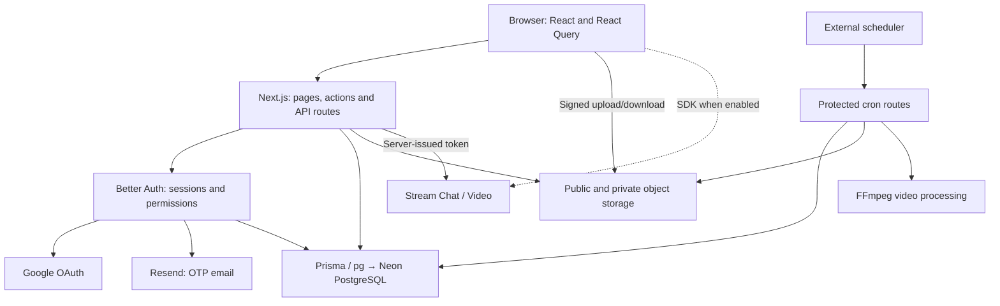

# Knovest — quick revision notes

Codebase snapshot: 18 October 2026. Read this as an implementation guide, not production certification.

## 1. Application and architecture

Knovest combines social posts, creator profiles, financial-learning articles/courses, chat and live rooms.

It is a **modular monolith**: one Next.js application contains frontend and backend logic, organized by feature. External services provide authentication support, persistence, files and communication.

| Technology | Responsibility |
| --- | --- |
| Next.js 16 / React 19 | Routing, rendering, interactive UI and backend entry points |
| Better Auth | OTP/Google sign-in, sessions, account switching and admin permissions |
| Prisma + Neon PostgreSQL | Typed queries; users, relationships, content, enrollments and jobs |
| Neon object storage | File bytes; database records hold keys and metadata |
| Stream | Chat and live audio/video transport |
| React Query | Browser data cache, pagination and mutation state |

**Release state:** payments are disabled. Production Stream connections and new lesson-video uploads/processing remain gated. A scheduler and qualified persistent video worker still need operational setup. Existing authorized lesson playback is separate.

## 2. Main flows

### Authentication

`Email → OTP delivery → verify code → session cookie → protected application`

Google OAuth is an alternative; passwords are disabled. OTPs expire after ten minutes, are stored hashed, and allow three incorrect attempts. Server session checks reject deleted or actively banned accounts.

Roles are `USER`, `ADMIN` and `SUPER_ADMIN`. Creator access derives from expert verification or an admin role—not a separate active `CREATOR` role.

### Posts and feed

`Composer → server checks → database write → React Query cache update`

Visibility can be public, private, followers-only or subscriber-only. Shared access rules protect feeds, direct reads, media, comments, bookmarks and reposted originals. Deleted content is excluded. Feed pagination fetches bounded batches.

### Verification and courses

`Verification draft → private evidence → submission → manual review → creator eligibility`

Reviewed applications cannot be changed through draft submission. Public profiles expose an approved summary, not private documents. A badge records review; it does not guarantee continuing registration or investment outcomes.

`Published free course → Pending enrollment → server confirmation → Active enrollment → lessons`

The server checks enrollment ownership and actual price. Lesson access requires ownership or active enrollment in the correct published course. A client confirmation cannot grant paid access.

### Files and playback

`Upload permission → signed URL → direct storage upload → server confirmation → attach key`

The server checks ownership, budgets, object size/type and file signatures. Keys must match the correct user/post or course/lesson namespace.

Post media and sensitive documents stay private. Authorization routes issue temporary download URLs. HLS splits video into a playlist and segments; each segment request checks access and gets a fresh signature.

### Jobs and deletion

`Delete content + enqueue cleanup in one transaction → scheduled job → storage deletion`

Jobs use leases, retry limits and conditional writes. Storage calls run outside the database transaction.

Video processing, when enabled: `multipart upload → UPLOADED → PROCESSING → FFmpeg HLS → READY / FAILED`. The current processor runs through a Next.js route; a separate worker service has not been deployed.

## 3. Important Next.js concepts

| Concept | Meaning in this application |
| --- | --- |
| **App Router** | `src/app` defines routes. `page.tsx` renders a destination; `layout.tsx` wraps a section. |
| **Route groups** | `(marketing)`, `(auth)` and `(platform)` organize layouts without appearing in URLs. |
| **Dynamic segments** | `[courseId]` and `[username]` capture URL values. Current route handlers await promise-based `params`. |
| **Server Components** | Default for pages/layouts. Read sessions and query Prisma directly on the server; pass safe results to UI. |
| **Client Components** | `"use client"` enables state, events, effects and browser SDKs. Initial HTML can still be server-rendered. |
| **Hydration** | React attaches browser behavior to rendered HTML, making controls interactive. |
| **Server Actions** | `"use server"` exposes async server functions to UI calls. Every action still needs validation and authorization. |
| **Route Handlers** | `route.ts` implements HTTP endpoints: authentication, media, health and cron jobs. |
| **Proxy** | `proxy.ts` handles request-level headers and an admin cookie-presence redirect. Presence alone is not authentication. |
| **Static/dynamic rendering** | Marketing pages can be prerendered; personalized platform routes use request-time rendering. Server Components do not necessarily run on every request. |
| **Loading/error boundaries** | `loading.tsx` supplies Suspense loading UI; error files provide recovery. `redirect()` and `notFound()` control routing outcomes. |
| **Revalidation** | `revalidatePath()` refreshes affected Next route data after writes. Browser React Query invalidation is separate. |
| **Images/fonts/metadata** | `next/image`, `next/font`, canonicals, robots and sitemap improve delivery/discovery. Private post images bypass the public optimizer cache. |
| **Providers/React Compiler** | Providers share theme, query and SDK state. Account-keyed providers reset cached private data on switching. Compiler optimization does not replace caching or effect cleanup. |

### Caching: keep the layers distinct

- React `cache()` deduplicates relevant server work within a rendering request.
- React Query caches browser data and updates it after mutations.
- HTTP/storage caching is another layer; private responses use restrictive caching.
- Better Auth cookie session caching is disabled for fresher authorization.
- Prisma queries are not automatically persistent Next.js cache entries. Cache Components/`use cache` are not currently enabled here.

## 4. Other concepts to remember

| Concept | Quick explanation |
| --- | --- |
| Authentication / authorization | “Who are you?” / “May you access this resource?” Check both. |
| RBAC + ownership | Roles grant broad capabilities; ownership, membership and enrollment narrow resource access. |
| Runtime validation | TypeScript checks development-time types; Zod checks incoming network data. |
| DAL / DTO | Centralized data/access rules / a deliberately limited response object. |
| `server-only` | Prevents sensitive modules entering client bundles; does not authorize callers. |
| Transaction | Related database changes commit or roll back together. |
| Lease / compare-and-set | Temporary job ownership / conditional updates that reject stale workers. |
| Pagination / index | Bounded result batches / faster supported query patterns; measure actual performance. |
| Rate limit / quota | Request-frequency control / workload allocation; neither guarantees a provider billing cap. |

## 5. Code-reading order

Paths are relative to the repository root:

1. `src/app/layout.tsx`, `src/app/(platform)/layout.tsx` — composition and providers.
2. `src/lib/auth.ts`, `get-sessions.ts`, `safe-action.ts` — identity and action boundaries. Some actions implement their own guards.
3. `src/features/posts/access.ts`, `actions/create-post.ts` — one complete feature flow.
4. `prisma/schema.prisma` — relationships, constraints and persistent state.
5. `src/features/courses/media-response.ts`, `src/lib/storage/` — file delivery and lifecycle.

**Recall:** the browser handles interaction; the server validates and authorizes; PostgreSQL stores application truth; storage holds files; external providers need their own permissions. A signed URL or Stream token is a credential—not proof of every entitlement. Hiding a button or adding `noindex` does not protect data.

Remaining release gates: [remediation status](REMEDIATION-STATUS-2026-10-18.md) and [release runbook](RELEASE-RUNBOOK.md).
